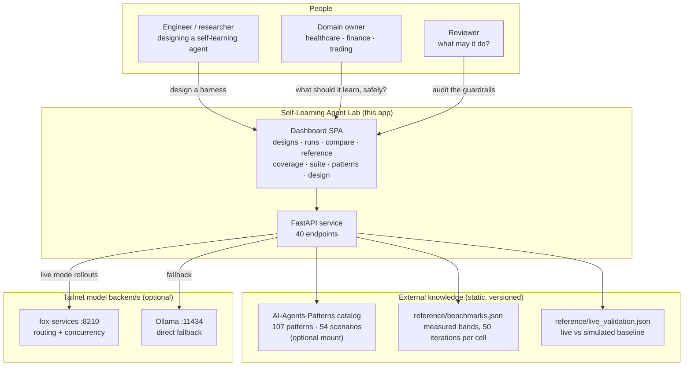
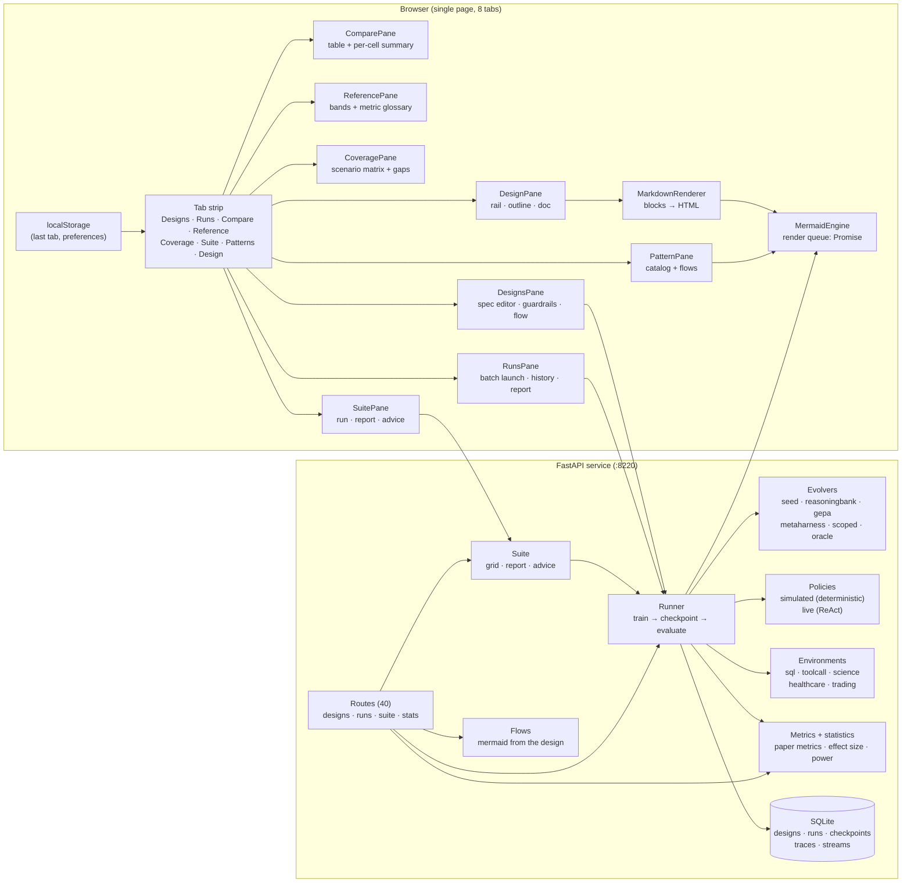
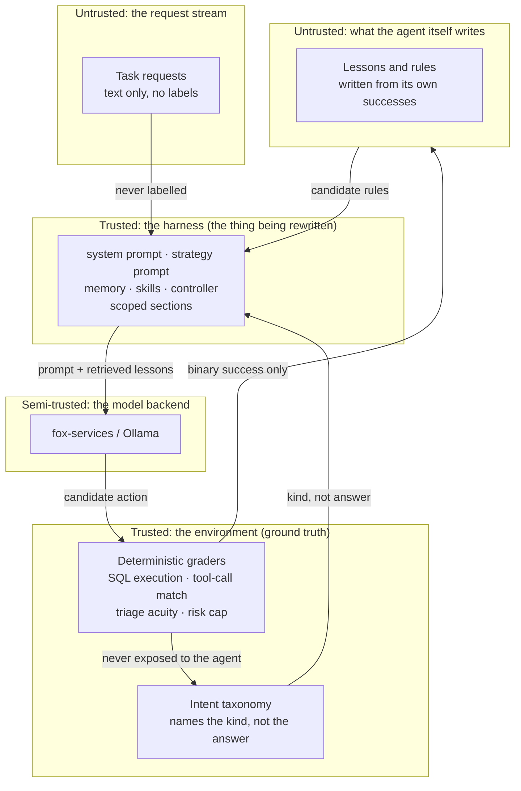
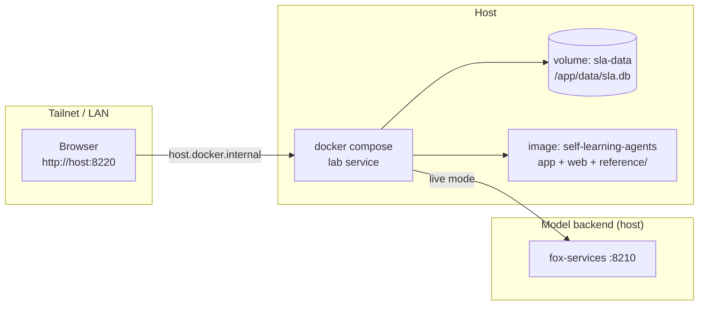

# System Context

**What this system is:** a lab for designing, building and *testing* self-learning agents — harnesses that rewrite themselves from experience, over a stream of task families that drift underneath them. It reproduces the protocol and the metrics of arXiv:2610.25858 ("Are Self-Evolving Agents Continual Learners?"), and adds the mechanism the paper asks for: task-scoped learning with workflow conditioning.

It is deliberately the same shape as the AI-Agents-Patterns dashboard: a single-page vanilla-JS app with a tab strip, a design tab that renders markdown + Mermaid documents live, and no build step. Mermaid is vendored under `web/vendor/` (the CDN is only a fallback), so the whole app works offline on a tailnet.

## Purpose & principles

- **Nothing is a screenshot.** Every diagram is Mermaid source stored in `design/*.md`, rendered at view time — a diagram that has changed cannot be mistaken for a correct one. The same rule applies to the *agent* diagrams: the flow drawn in the Design tab is generated from the running code.
- **The harness is the subject.** The model is frozen. Adaptation happens by rewriting the harness — prompt, memory, skills, controller — never the weights. Every method here is a different rule for rewriting it.
- **Guardrails outside the model.** Escalation-first triage, the position cap, "ask before acting" — these are enforced by the grader and by the audit, not by instructions in a prompt.
- **A number without a reference is not a result.** Every run is judged against measured bands, and every comparison carries an effect size, a corrected significance verdict and a cost.
- **Everything is inspectable.** Designs, runs, checkpoints, harness snapshots and retrieval traces are plain rows in SQLite; the whole collection exports as JSON.

## Context diagram

## Container overview

## Trust boundaries

The important boundary is between **T3 and T5**: the environment's ground truth grades the agent, but only a *binary* success signal crosses back. The agent never sees a label, a gold answer, or a similarity to one. Everything the harness accumulates is derived from its own trajectory, which is why a lesson can be wrong and why the scoped evolver's job is to make sure the wrong ones do not reach the wrong tasks.

## Deployment

The reference data (measured bands, the live comparison) ships **inside the image** at `/app/reference`, deliberately outside the runtime volume at `/app/data`. A volume mounted over the shipped path would shadow it, and the app would silently fall back to stale bands — which is exactly what happened once, and is now covered by a test.
