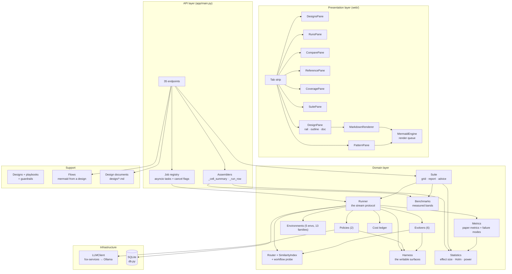
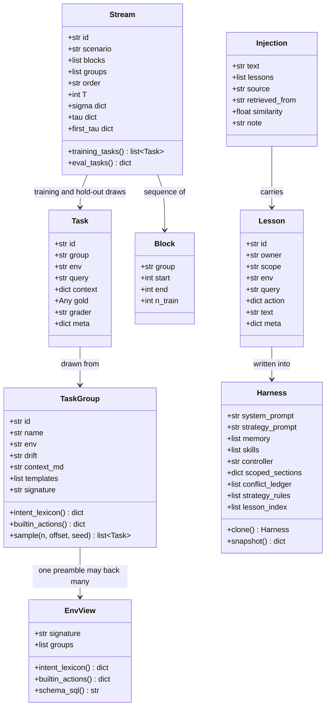
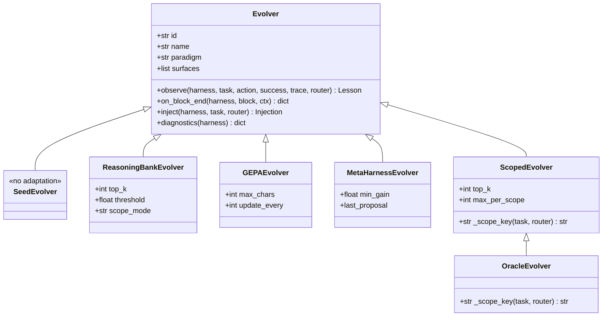
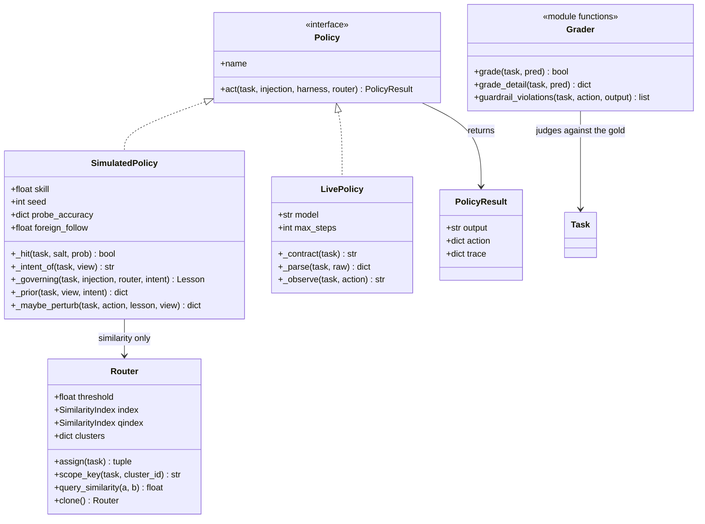

# UML — Components & Classes

Static structure of the lab. Four views: the component diagram, the core
domain classes, the evolver hierarchy (the part that actually matters), and
the interface contracts the runner relies on.

## Component diagram

## Core domain classes

`EnvView` is the piece that keeps the lab honest. A task family is
identified by its **preamble**, not by its label: the two BFCL families
share one API catalogue, so a view of the environment holds *both* of them
and the agent must work out from the request which one it is in. A policy
handed `task.group` would be reading the answer key.

## The evolver hierarchy

The harness is the only thing that changes. Each evolver is a different
rule for rewriting it.

`OracleEvolver` inherits everything from `ScopedEvolver` and changes one
method: `_scope_key`. That is deliberate — it makes the oracle a strict
superset of the scoped evolver's information (it knows the family instead
of guessing the cluster), so it is a true ceiling rather than just another
method. The suite reports how much of that ceiling the best real method
captured.

## Interfaces the runner relies on

Two indices, not one. `Router.index` clusters on the **feature text**
(preamble + request) and decides which family a task belongs to.
`Router.qindex` matches on the **raw request** and is what a memory store
actually retrieves on. Conflating them is the bug the paper describes: the
agent retrieves the nearest *topic* and applies it to a task that needs the
opposite *workflow*.
