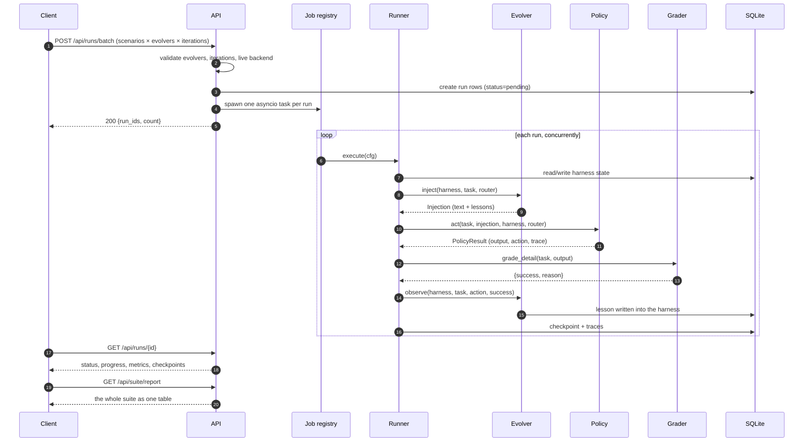
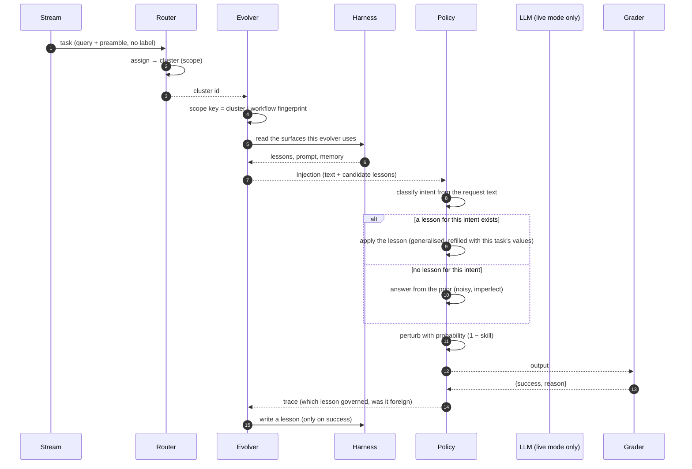
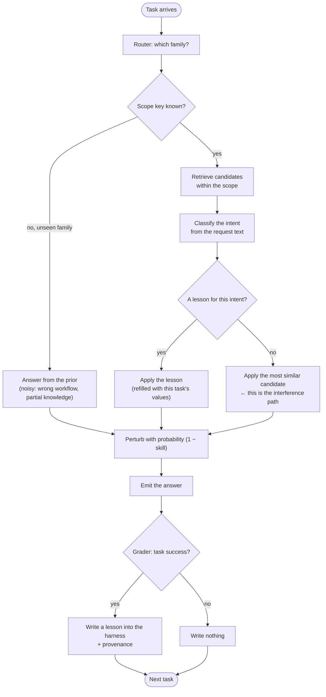
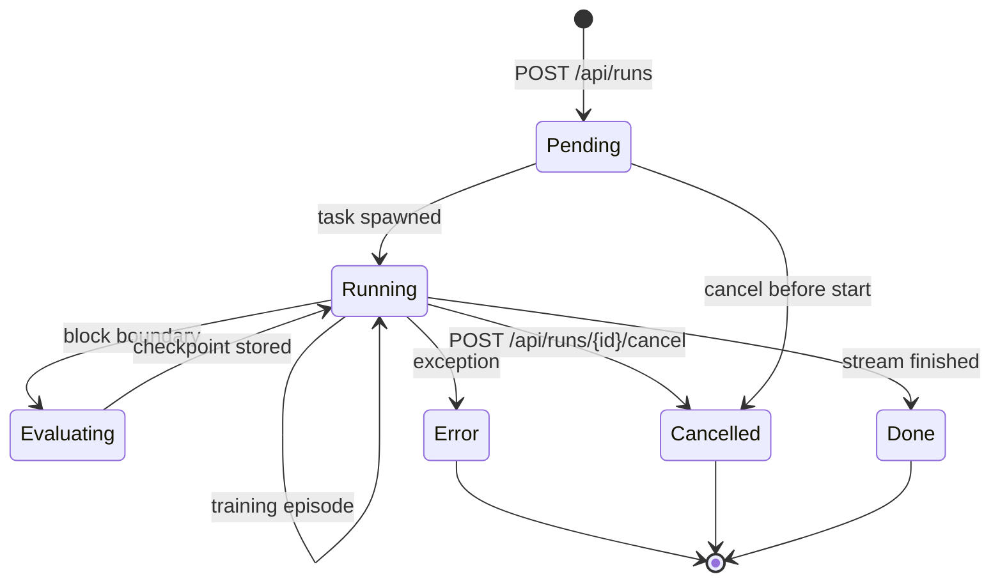
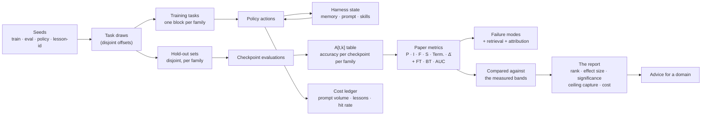

# Control Flow — Transactions, Activity & State

How a run actually moves. Four views: the run as a transaction between the
client and the service, the episode as a transaction between the harness
and the model, the activity of one training episode, and the state machine
a run passes through.

## The run transaction

The client asks for a comparison; the service does the work in the
background and the client polls. A run is never a request that blocks.

Two properties are worth stating because they are easy to get wrong.
First, the grader is called **after** the policy, and only a boolean comes
back: no label, no gold answer, no similarity score crosses the boundary
into the harness. Second, `observe` is called on *every* episode but only
writes a lesson on a success — a failure teaches the harness nothing, which
is what makes the failure modes interesting.

## The episode transaction

The agent's own loop, with the harness in the middle. This is the loop the
paper's scenarios are about.

The `alt` branch is the whole subject of the lab. When the candidate
lessons contain none for the current intent, the policy falls back to the
most similar one anyway — the agent has no way of knowing that the
knowledge it was handed was learned somewhere else. That fallback is the
interference mechanism, and it is why a *scope* check upstream of the
policy matters more than any amount of prompt polish.

## Activity — one training episode

## The run state machine

`Evaluating` is not a separate lifecycle state in the database — a run is
`running` from the first episode to the last — but it is a distinct
*phase* in the runner, and it is where the cost of a run concentrates: a
checkpoint evaluates **every** family in the stream, not just the one that
was just trained on. That is what makes forgetting visible at all.

## Data flow: one run, end to end

Every step is seeded. `A[t,k]` is the join of the two draws: the training
tasks drive the harness, the hold-out tasks measure it, and the offsets
keep them disjoint so a family is never graded on an instance the agent
was trained on.
