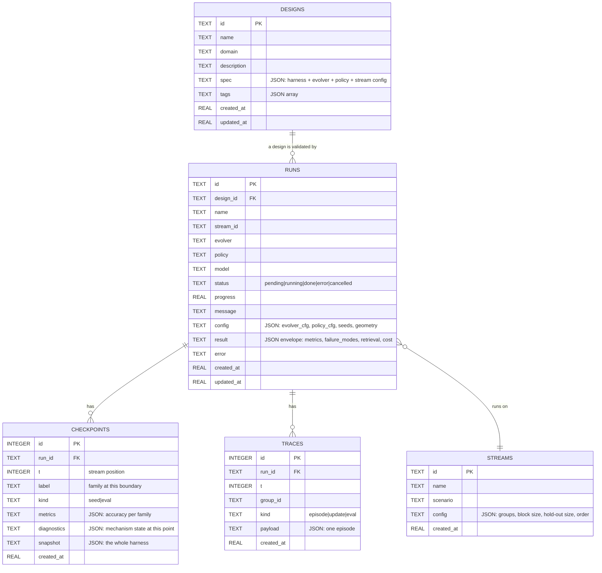
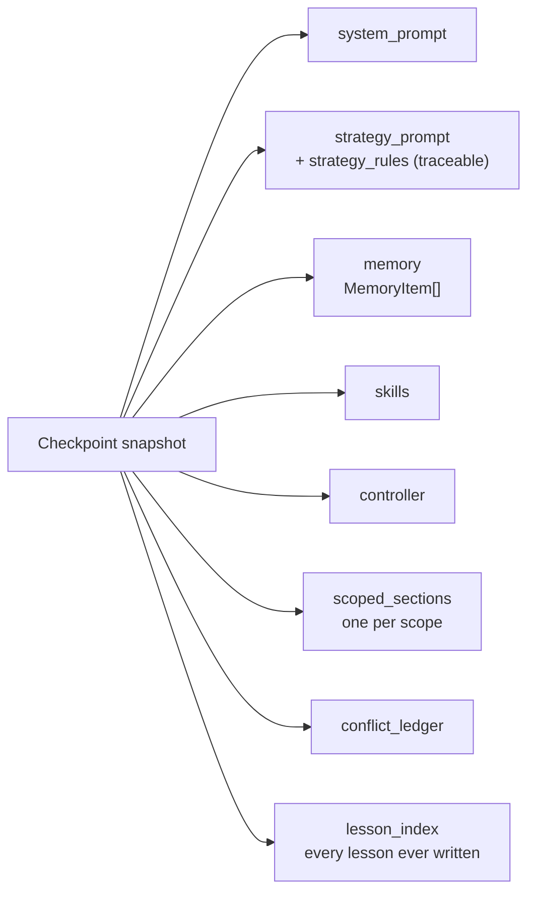
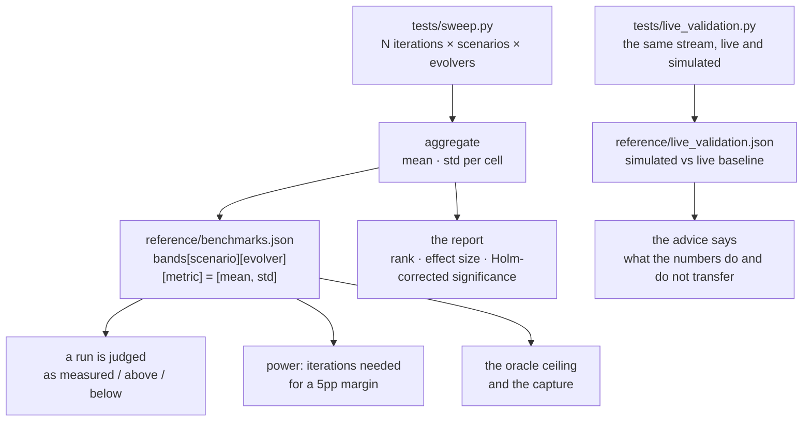
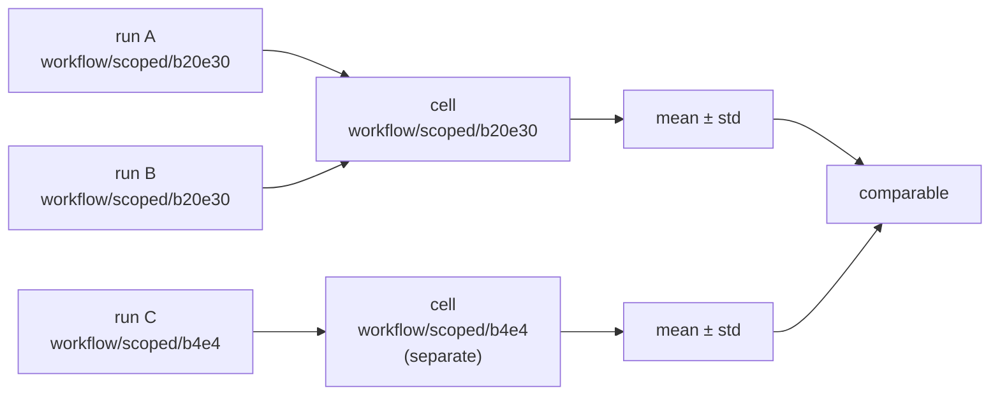

# Data Model — Storage, Snapshots & Reference Data

Three things persist: the lab's own records (SQLite), the harness state a
run carries (snapshots), and the measured reference data the suite judges
runs against. The last one is *reference*, not state — and confusing the
two is how the container once served stale bands for a day.

## ER diagram — the lab's records

The `result` column is an **envelope**, not a bare metrics blob: metrics,
the detected failure modes, the retrieval diagnostics, the prompt
attribution and the cost ledger travel together, so a report can be
rebuilt from the database without re-running anything.

## The harness snapshot

What a checkpoint stores is the whole writable state, so two checkpoints
can be diffed to see exactly what the method changed.

`strategy_rules` is the one that matters. The strategy prompt is a
*rendering* of a list of rules, and each rule carries the lesson id and
the cluster that wrote it. That is what makes the paper's Figure 3
measurable: a family's share of the prompt can be attributed, and a fall
in that share is a later block overwriting an earlier one rather than an
opaque edit.

`conflict_ledger` is the scoped evolver's honesty about itself: when one
discovered cluster carries two incompatible workflow fingerprints, that
collision is recorded rather than silently resolved.

## The reference data model

Two shipped files, outside the runtime volume, that the suite judges
against.

`bands[scenario][evolver][metric]` is a two-element array — mean and
standard deviation — because that is all a band needs to be useful, and
anything more would be precision the measurements do not support.

## The cell identity rule

Runs are only comparable when they used the same configuration, so a cell
is keyed by `(stream, evolver, block size, hold-out size)`.

Mixing geometries in one cell produces a variance that is mostly the
difference between the geometries, and a comparison against that cell says
nothing: a 22pp margin can come out "not significant" purely because a
4-episode probe run was in the bucket. The report shows each cell's
geometry so the reader can see it.

## Storage format & versioning

| what | where | format | versioned |
|---|---|---|---|
| designs, runs, checkpoints, traces | SQLite at `/app/data/sla.db` | SQL + JSON columns | schema created idempotently on start |
| harness state | inside a checkpoint's `snapshot` column | JSON | snapshot carries the harness `version` |
| reference bands | `reference/benchmarks.json` | JSON | ships with the image; regenerated by `--refresh-benchmarks` |
| live comparison | `reference/live_validation.json` | JSON | ships with the image; regenerated by `tests/live_validation.py` |
| exports | `./exports/<slug>/` | a runnable project | includes `design.json`, `run_agent.py`, `GUARDRAILS.md` |

The database is created with `CREATE TABLE IF NOT EXISTS`, so starting the
service against an existing file is safe and starting it against nothing
produces a working schema. Nothing in the schema depends on the order in
which runs were created.
