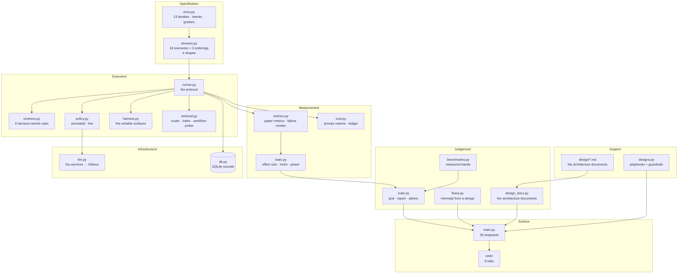
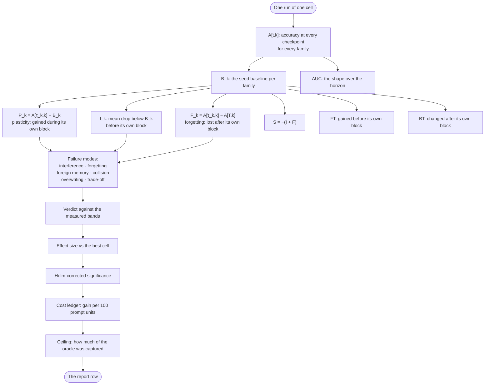
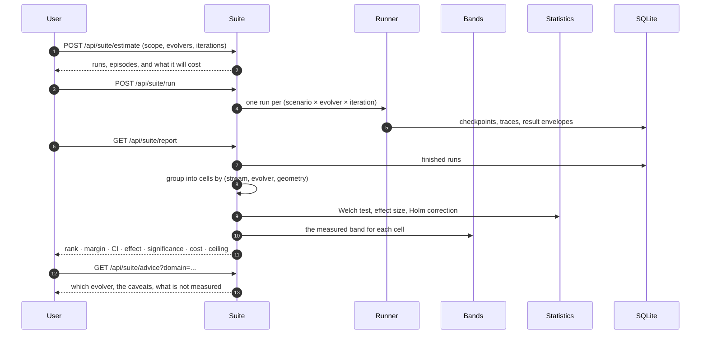
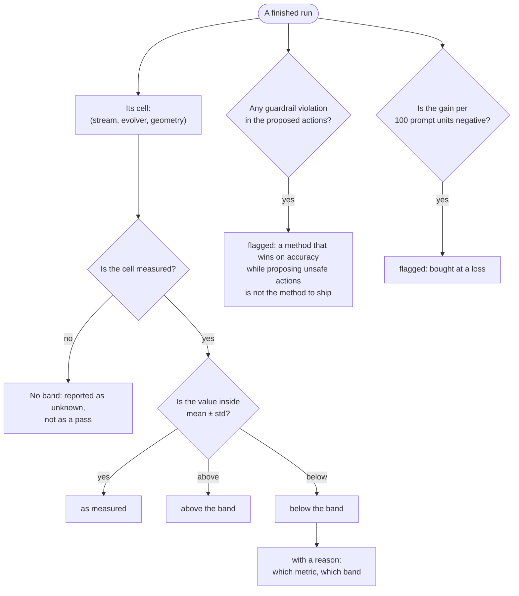
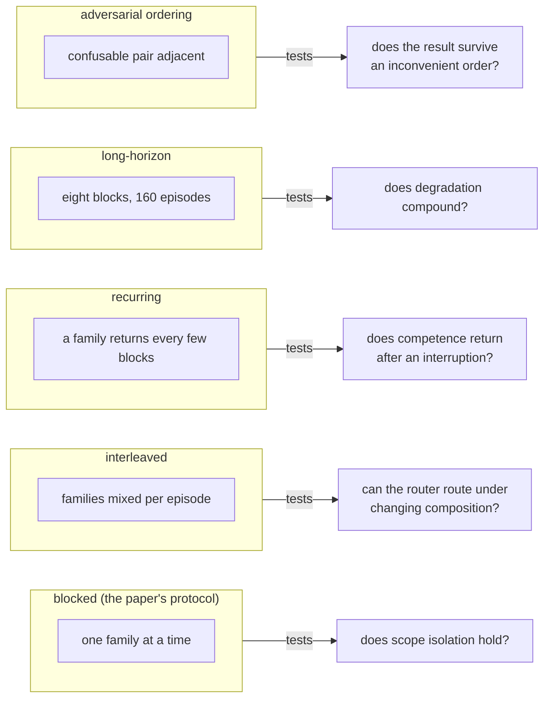
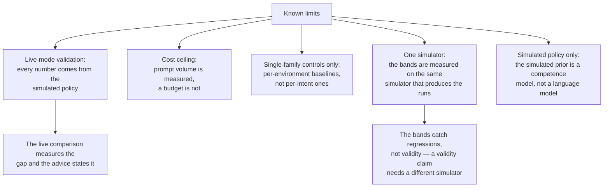

# Evaluation Suite — Modules, Pipelines & Verdicts

The suite is the product: an agent that cannot be measured cannot be
shipped. This document explains how the measurement is put together, what
each part contributes, and how a verdict is reached.

## Module map

## Module map

The layers below are how the code is organised. The dependency graph that
follows is **generated from the imports**, not drawn by hand, so it cannot
drift from the code.

<!-- GENERATED: module-dependencies -->

## The measurement pipeline

Every quantity above is a function of the same `A[t,k]` table, so the
report's numbers cannot disagree with each other: the metrics, the failure
modes, the effect sizes and the cost all come from one run's checkpoints.

## The comparison, as a transaction

## What each statistical layer contributes

| layer | question it answers | what it cannot tell you |
|---|---|---|
| mean ± std | how much the cell varies | whether two cells differ |
| Welch t-test | do two cells differ | by how much, or against how many comparisons |
| effect size (Cohen's d) | how big the difference is in pooled SDs | whether it is distinguishable from zero |
| Holm–Bonferroni | does the difference survive comparing many cells | — |
| power | how many iterations this cell would need | whether the current n was enough |
| cost ledger | what the gain cost in prompt volume | — |
| oracle ceiling | how much of the achievable gain was captured | — |

A cell with a large mean and a huge standard deviation is not a result.
Reporting all seven together is what makes a cell's number mean something.

## The verdict path

The three flags are independent. A method can be exactly as measured,
have zero guardrail violations, and still be a bad choice if it spends
three times the harness to get there.

## The scenario shapes

The shapes exist because the blocked protocol hid things. On the
eight-block stream, reasoningbank's interference reaches +16.0 and GEPA's
forgetting +22.6 — numbers the four-block streams made look mild. And on
the interleaved stream, interference *drops* for every method, because no
family is "pre-block" for long: the shape changes the numbers without
changing the ranking.

## What the suite does not measure

Stated plainly, because a suite that overstates its coverage is worse than
one that admits its edges.

The live comparison is the honest answer to the first limit: the local
model scores 100% where the simulator scores 50% on the trading family, so
the suite's **rankings** transfer and its **magnitudes** do not. The
suite's plasticity numbers are headroom, not expected production gains,
and the advice panel says so where the numbers are read.
