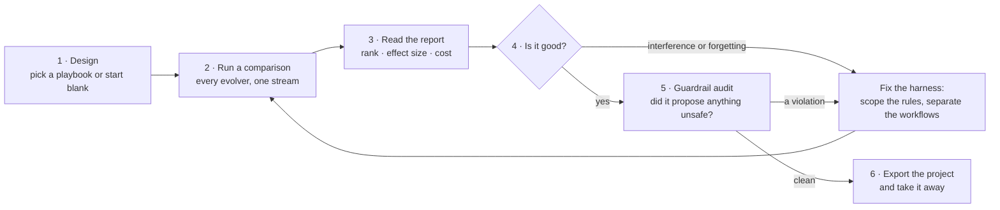
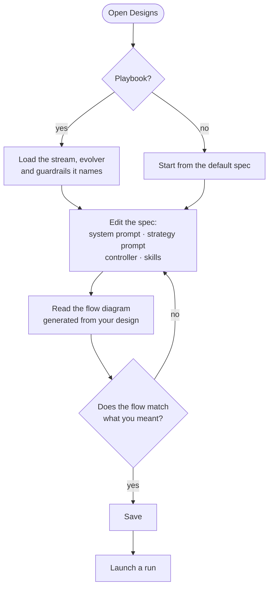
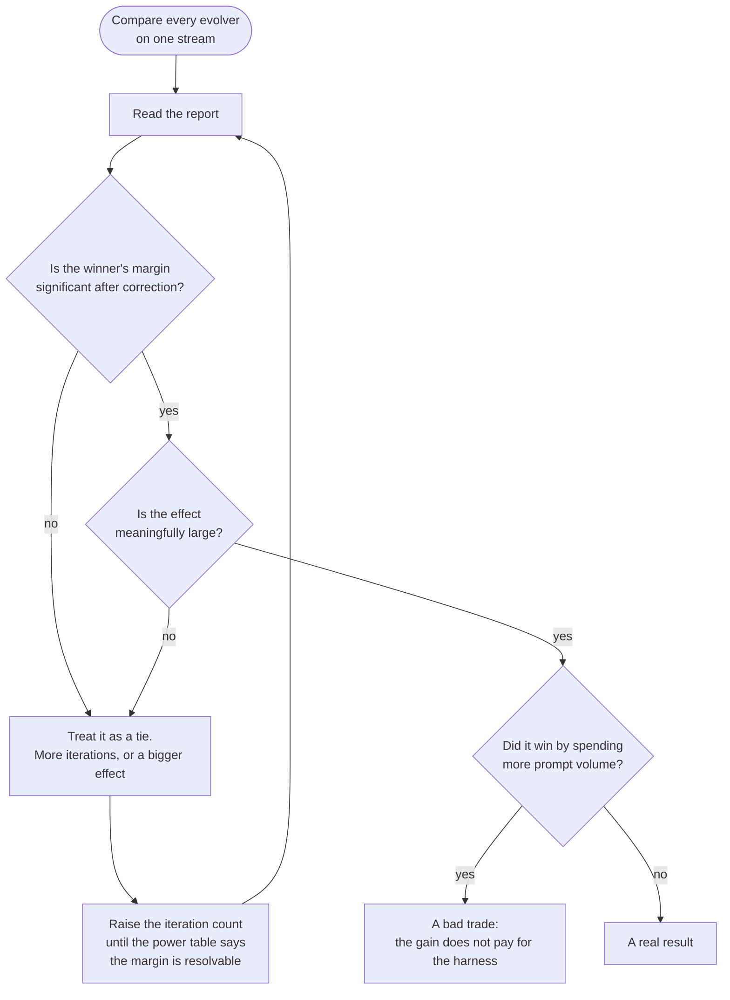
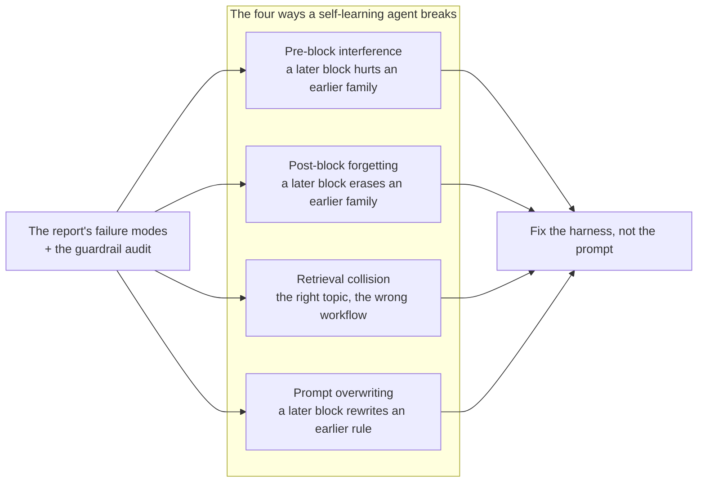
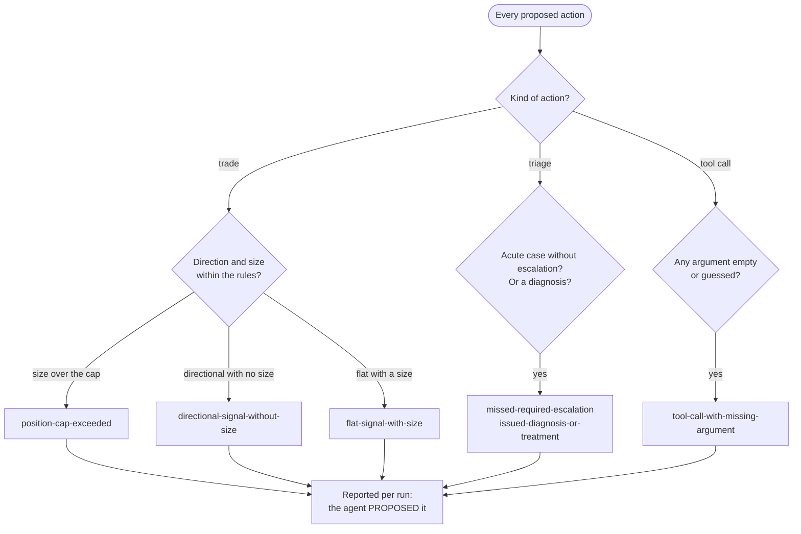
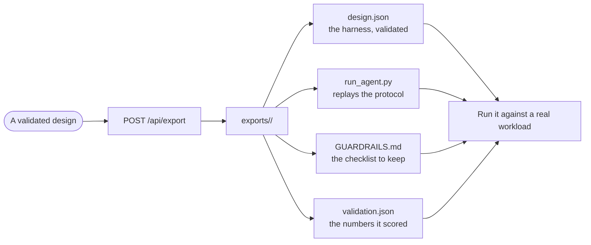
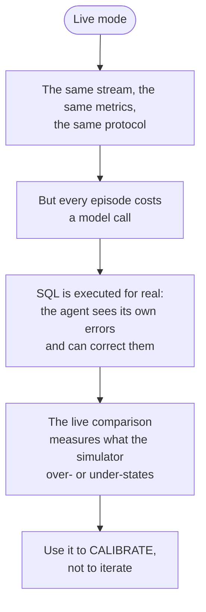

# Workflows — How a Person Uses the Lab

The app is a bench, not a demo. This document follows the paths a user
actually walks: designing an agent, proving it learns, proving it does
not break, and taking it away.

## The intended path

Step 1 is a playbook because starting from a blank spec is a trap: the
playbooks pair a stream with the evolver the measurements favour and the
guardrails that must stay on. Step 2 is a *comparison* because a single
run tells you nothing — the lab's whole claim is about differences
between methods, and a single number is not a difference.

## Designing an agent

The flow diagram is generated from the design, not drawn by hand, so it
cannot drift from the harness. If the diagram shows a shared strategy
prompt where you meant per-scope sections, the design says what you
actually built.

## Proving an agent learns

The power table is the answer to "how many iterations do I need?". It
reports, per cell, the power at the current *n* and the number of
iterations that would resolve a 5pp margin — so iterations are spent where
they buy resolution rather than uniformly.

## Proving an agent does not break

The four failure modes are the paper's findings, turned into named
diagnoses with the evidence attached. Each says what broke, how much, and
what kind of harness edit causes it.

## The guardrail audit

This audit is the difference between a measurement and a property. The
graders reject a bad *answer*; the audit asks whether the agent ever
*proposed* a breaking action. A method that wins on accuracy while
proposing an acute triage case without escalation is not the method to
ship, whatever its score.

## Taking the result away

The export carries the guardrail checklist so the guardrails travel with
the code. A harness exported without them is a harness someone will
quietly switch off.

## The live path

Everything above runs in simulated mode, which is deterministic, fast and
free. Live mode runs the same protocol against a real model.

Live mode is for calibration, not for iteration: a run takes minutes per
call, so the suite is not a place to iterate. Its job is to say how far the
simulated numbers transfer, and the answer it currently gives is that the
rankings transfer and the magnitudes do not.
