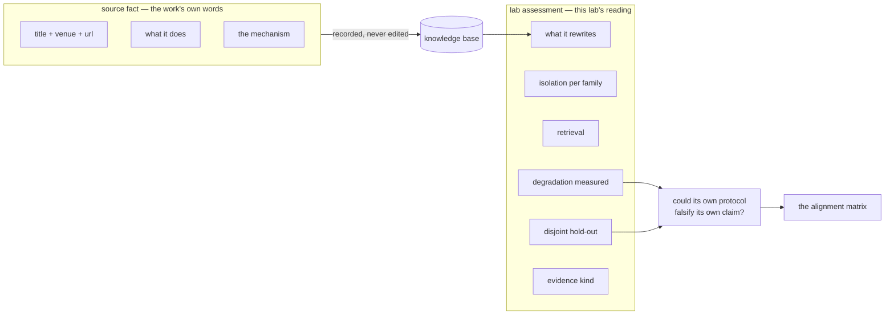
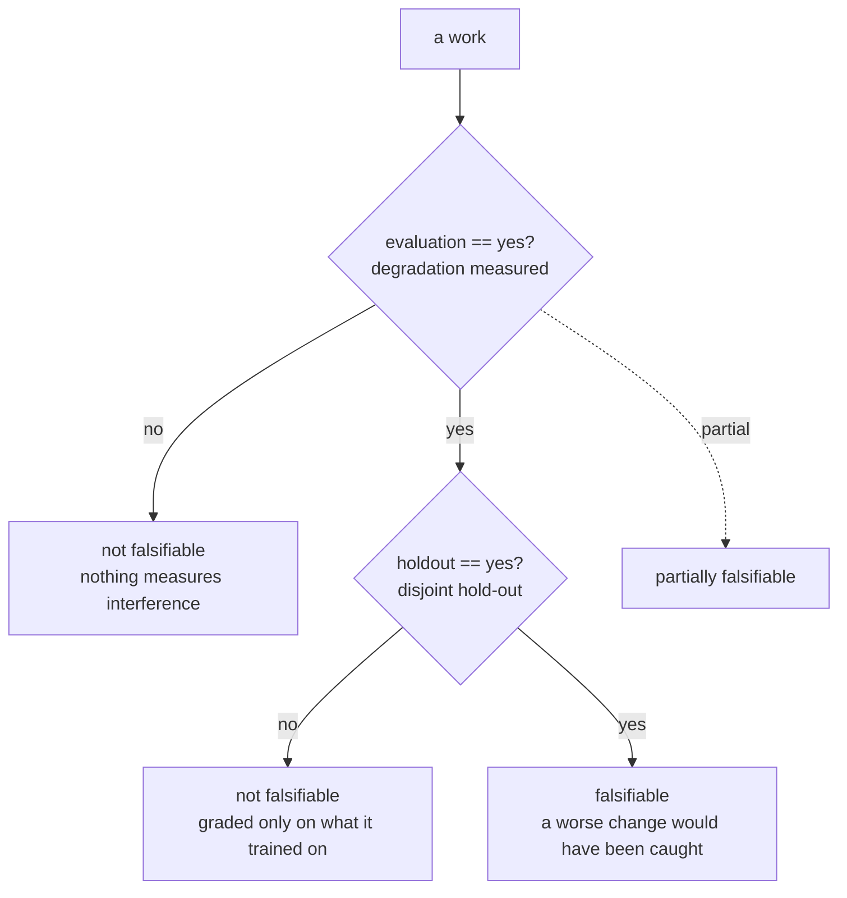
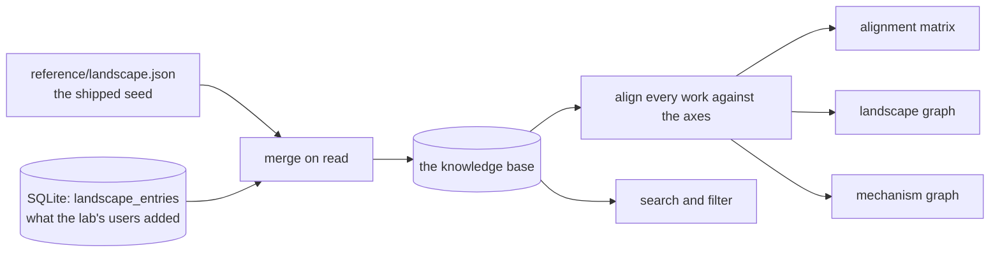
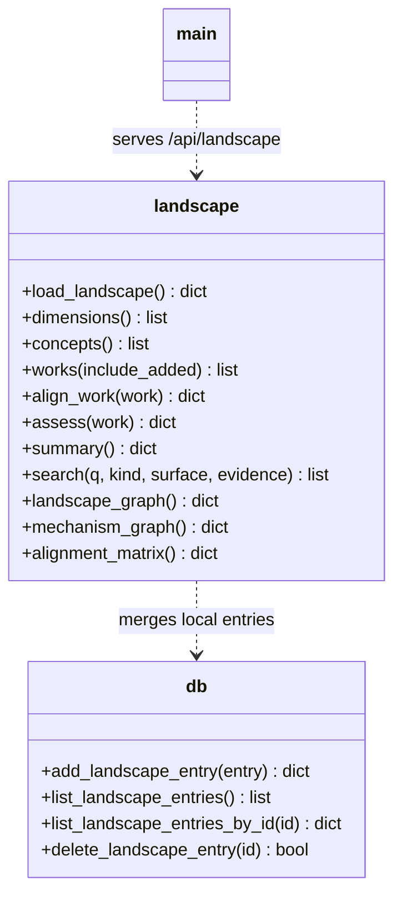

# Landscape — the field, aligned with the lab's axes

The Landscape tab collects the academic and industry field of self-improving
and self-learning agents — papers, products, frameworks, writeups, blogs —
and places it on the axes this lab measures.

It is not a reading list. A reading list says "read this". The alignment
matrix says *on what terms would this work have been checked, and could
its own protocol have checked it*.

## The epistemic contract

The tab is built on one distinction, and everything else follows from it.
There are two kinds of fact in every row, and they are never merged:

| kind | where it lives | who owns it |
|---|---|---|
| **source fact** | `title`, `authors`, `venue`, `summary`, `mechanism` | the work's authors |
| **lab assessment** | the `align` columns, the verdict | this lab, and it is opinion |

A source fact is stated conservatively — one line on what the work does, one
line on the mechanism — and always carries provenance: an arXiv identifier
or a canonical URL. Where an identifier could not be verified, the URL is a
search that always resolves rather than a guess.

A lab assessment is the lab's reading, and the UI says so on every row.
The rule that keeps this honest is in the code, not in a convention: a work
whose `align` is missing an axis is placed on it as `unknown`, never
guessed into a value.

The verdict is the column the tab exists to deliver, and it is *derived*,
never entered by hand.

## The axes

Six axes, each a closed set of options, each answerable by reading the
work. They were chosen because they are the questions the lab already asks
of its own evolvers — so the field and the lab are measured in the same
units.

| axis | question | options |
|---|---|---|
| `surface` — **What it rewrites** | which part of the harness changes when the agent learns? | nothing · prompt · memory · skills · workflow · code · weights |
| `isolation` — **Learning isolated per task family** | is what was learned kept from being applied to a family it was not learned on? | n/a · yes · partial · no |
| `retrieval` — **How a stored experience is matched** | when the agent recalls something, what decides that it applies? | none · similarity · intent · explicit key · cluster + workflow |
| `evaluation` — **Degradation measured** | does the work measure interference or forgetting across a changing stream? | no · partial · yes |
| `holdout` — **Disjoint hold-out** | is the agent graded on instances it was not trained on? | no · yes |
| `evidence` — **Evidence kind** | what kind of source is this? | peer-reviewed · preprint · vendor writeup · blog · open source |

`unknown` is a legal value on every axis. An axis that could only be
answered "yes" would be a decoration.

## The falsifiability rule

> **Could this work's own protocol have falsified its own claim?**

A work that claims to learn but measures nothing under drift, or grades
only on what it trained on, cannot be contradicted by its own results. A
self-improving agent that keeps every modification, because nothing in its
loop can reject a bad one, is not improving — it is drifting, with better
vocabulary.

The rule is mechanical:

`evaluation == yes AND holdout == yes` is falsifiable; `evaluation` in
(`yes`, `partial`) with `holdout == yes` is partially falsifiable;
anything else is not falsifiable by its own protocol.

On the current snapshot of 31 works: **1** is falsifiable, **7** are
partially, **23** are not. That is the gap this lab works in.

A survey is a special case the rule handles by the alignment, not by
special-casing the code: a survey's protocol is a literature review, not an
experiment, so it is marked as *documenting* the field's protocols rather
than running one.

## The knowledge base

Two sources, merged on read:

The shipped file lives in `reference/`, not `data/`. The runtime Docker
volume is mounted at `/app/data` and shadows anything shipped there — the
measured bands were shadowed once already, and the same trap applies to
every shipped reference file. A test now guards the primary path.

Entries a user adds are validated on the way in: the title is required, the
alignment values must be declared options, and the concept references must
resolve. An entry with no alignment is still admitted — it is a work that
has not been placed on the axes yet, and the axis says `unknown`.

## The two graphs

Both are **generated from the same data as the table**, so a picture can
never disagree with the numbers.

| graph | nodes | edges | question it answers |
|---|---|---|---|
| **landscape** | works + concepts | `implements` | what is this area actually made of? |
| **mechanism** | concepts, grouped by `surface` | `groups` | what kind of thing is being changed? |

The landscape graph groups the works by kind — papers, products,
frameworks, writeups — so the picture has a shape a reader can follow
rather than forty-six boxes in a column.

## Module

The whole subsystem is `app/landscape.py`, with `app/db.py` holding the
locally-added entries and `app/main.py` serving them.

The module is read-mostly and side-effect free apart from the merge, which
is why the whole knowledge base can be tested as a pure function of its
inputs.

## What the tab deliberately does not do

- **It does not scrape.** A crawler against arXiv and vendor sites is
  fragile, slow and unauditable. A curated set with provenance is
  checkable, and the API accepts additions so the set can grow under
  supervision.
- **It does not rank works.** Popularity is not quality. The standard here
  is the protocol, not the citation count.
- **It does not claim a work is good.** It places the work on the axes and
  says whether its protocol could have falsified its own claim. Whether a
  work *is* good is a different question, and one this tab does not answer.
- **It does not conflate the axes with the lab's own results.** A work
  being aligned to `memory` says nothing about whether the lab's `memory`
  evolver measured well; those are two different sets of numbers, and the
  tab keeps them apart.
